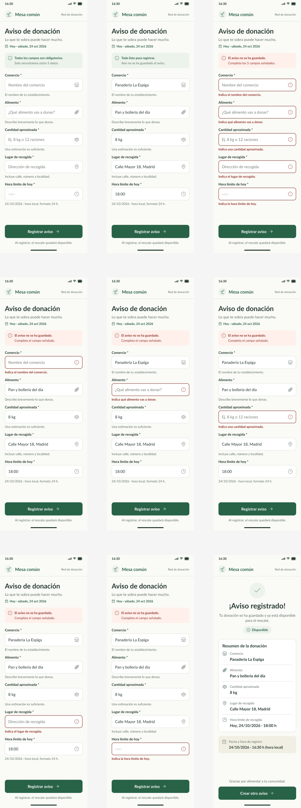

# Prototipo móvil (360 px) - Formulario de aviso con estados de error por campo

## Descripción
Este prototipo presenta la versión móvil del formulario para registrar un aviso de alimento disponible, pensado para una interfaz de 360 px de ancho. La intención es validar la experiencia del comercio al completar la información del rescate y visualizar los estados de error por campo antes de enviar el formulario.

## Objetivo
Validar el flujo de registro del aviso con los siguientes criterios:
- la información requerida se presenta de forma clara
- cada campo tiene validación visual
- los errores son entendibles para el usuario
- el formulario facilita la corrección antes del envío
- la experiencia funciona en dispositivos móviles

## Enlace al prototipo
- Figma: [Agregar enlace de Figma]
- Versión exportada: `docs/design/prototipo-formulario-aviso/formulario-aviso-360.png`

## Captura del prototipo

## Alcance del diseño
El prototipo incluye:
- formulario de registro de aviso
- campos obligatorios
- estados de validación por campo
- mensajes de error claros
- estado visual de éxito al enviar
- diseño ajustado para mobile 360 px

## Campos del formulario
Los campos considerados en este prototipo son:
- nombre del comercio
- tipo de alimento
- cantidad aproximada
- lugar de recogida
- hora límite
- observaciones adicionales

## Estados de error por campo
Cada campo debe mostrar una respuesta clara según el estado del formulario:

| Campo | Estado vacío | Estado con error | Estado correcto |
| --- | --- | --- | --- |
| Comercio | Se solicita completar el campo | Se indica que el campo es obligatorio | Se muestra el valor ingresado |
| Tipo de alimento | Se solicita completar el campo | Se indica que debe seleccionarse una opción | Se muestra la opción elegida |
| Cantidad aproximada | Se solicita completar el campo | Se valida si el valor es válido o si no es numérico | Se muestra la cantidad ingresada |
| Lugar de recogida | Se solicita completar el campo | Se indica que la información es obligatoria | Se muestra la dirección o lugar |
| Hora límite | Se solicita completar el campo | Se valida si la hora es válida | Se muestra la hora seleccionada |
| Observaciones | Opcional | No aplica | Se muestra el texto si fue ingresado |

## Flujo propuesto
1. El usuario abre el formulario.
2. Completa la información requerida.
3. Si falta algún dato, el sistema marca el campo con error y muestra un mensaje breve.
4. El usuario corrige la información.
5. Al enviar, si todo está correcto, el formulario confirma la acción.
6. El sistema deja listo el registro para continuar con el siguiente paso del flujo.

## Reglas visuales contempladas
- Los errores deben ser visibles sin saturar la pantalla.
- El mensaje de error debe estar cercano al campo relacionado.
- Los campos obligatorios deben diferenciarse claramente.
- Los textos deben ser cortos, directos y comprensibles.
- La interfaz debe mantener legibilidad y orden en pantallas pequeñas.

## Criterios de revisión
Este prototipo se considera válido si:
- el usuario entiende qué información debe completar
- cada error se explica claramente
- no hay ambigüedad en los mensajes
- el flujo es natural desde la primera interacción hasta el envío
- la interfaz se ve consistente en una pantalla móvil de 360 px

## Archivos del prototipo
- `docs/design/prototipo-formulario-aviso/README.md`
- `docs/design/prototipo-formulario-aviso/formulario-aviso-360.png`

## Observaciones
Este diseño se ha desarrollado como aporte visual para la validación del flujo del formulario de aviso. Se recomienda revisarlo con el equipo antes de continuar con la implementación en frontend.