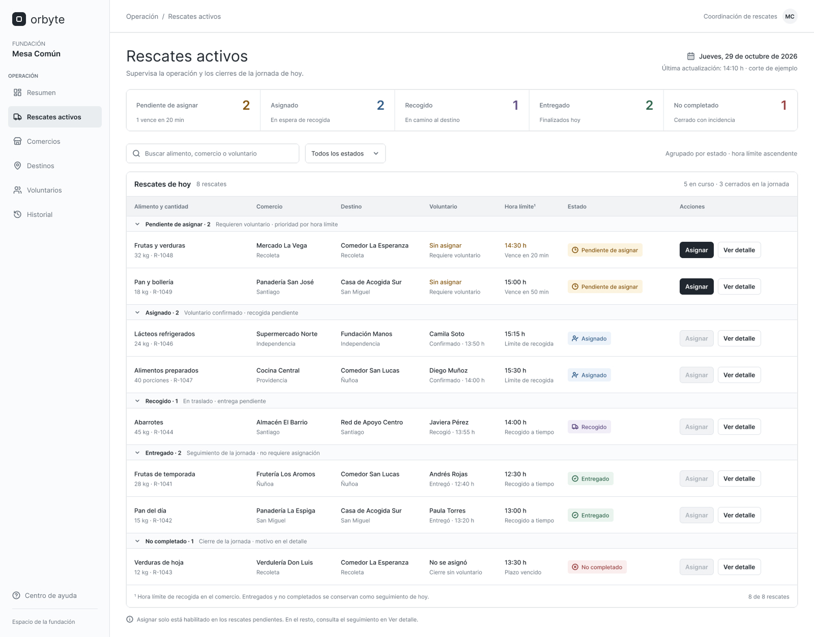
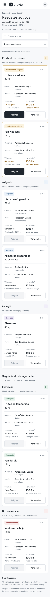

# Diseño de «Rescates activos» — tabla por estado e indicador de pendiente de asignar

## Descripción
Este prototipo presenta la vista operativa de la Fundación para consultar los rescates activos. La interfaz está orientada a la revisión rápida de rescates, identificación de estados y priorización de aquellos que requieren asignación.

## Objetivo
Diseñar el panel operativo de la fundación a partir del wireframe del coordinador, con foco en la gestión diaria de rescates activos.

## Trazabilidad
- Historia: CMP-03 · La fundación hace seguimiento de los rescates
- Criterios de aceptación: CA-03.1, CA-03.2
- Requerimientos: RF-009, RF-011, RF-022, RF-023

## Alcance del diseño
La vista incluye:
- una tabla por estado de rescates activos
- columnas para:
  - alimento y cantidad
  - comercio
  - destino
  - voluntario
  - hora límite
  - estado
- acciones:
  - Asignar
  - Ver detalle
- versión desktop
- versión mobile

## Reglas clave de diseño
- El estado debe mostrarse como etiqueta con texto, no solo color.
- Un rescate disponible debe aparecer como “Pendiente de asignar”.
- La diferencia entre estados debe ser clara sin depender del color.
- La vista debe permitir una revisión rápida para la fundación.
- Las acciones deben ser visibles y fáciles de identificar.
- El diseño debe ser útil para operaciones, no solo visualmente atractivo.

## Estado visual propuesto
Los estados representados en la interfaz son:
- Pendiente de asignar
- Asignado
- Recogido
- Entregado
- No completado

## Enlace del prototipo
- Figma: [Agregar enlace]
- Documento de referencia: [Agregar enlace]

## Capturas del prototipo

### Versión desktop


### Versión mobile


## Estructura de archivos
```text
docs/design/rescates-activos/
├── README.md
├── rescates-activos-desktop.png
├── rescates-activos-mobile.png
└── referencias/