# Manual de operación de Orbyte

Para Marcela y Diana, de la Fundación Mesa Común (#61). Explica las tareas de todos los días sin necesitar al equipo técnico.

- **Aplicación:** https://orbyte-dun.vercel.app
- Funciona en celular y en computador. No hay que instalar nada.

Las capturas usan datos de demostración. Los nombres que dicen "(demo)" o "Demo" no son reales.

## Contenido

1. [Antes de empezar el día](#1-antes-de-empezar-el-día)
2. [Cuentas: entrar, registrarse y aprobar](#2-cuentas-entrar-registrarse-y-aprobar)
3. [Tareas de la fundación](#3-tareas-de-la-fundación)
4. [Lo que hacen comercios, voluntarios y organizaciones](#4-lo-que-hacen-comercios-voluntarios-y-organizaciones)
5. [Si algo falla](#5-si-algo-falla)
6. [Estados de un rescate](#6-estados-de-un-rescate)

## 1. Antes de empezar el día

El servidor se apaga solo cuando nadie lo usa durante 15 minutos. Encenderlo de nuevo tarda cerca de **un minuto**.

1. Abre https://orbyte-api-ecow.onrender.com/health.
2. Espera a que aparezca `{"status":"ok"}`. Puede tardar hasta un minuto la primera vez.
3. Ya puedes abrir la aplicación.

Haz lo mismo unos minutos antes de una presentación o reunión.

## 2. Cuentas: entrar, registrarse y aprobar

### Iniciar sesión

Entra a la aplicación, toca **Iniciar sesión** y escribe tu correo y tu contraseña.

- La sesión dura **60 minutos**. Después la aplicación te pide entrar de nuevo.
- La sesión vale solo en la pestaña donde entraste. Si abres otra pestaña, tienes que entrar otra vez.

### Crear una cuenta

Cualquier persona puede crear su cuenta en **Crear una cuenta**, desde la pantalla de inicio de sesión. Debe elegir su rol:

| Rol | ¿Puede usarla de inmediato? |
|---|---|
| Voluntario | Sí |
| Organización receptora | Sí |
| Comercio | No. Primero la fundación o la administración la aprueba |
| Fundación | No. Primero la administración la aprueba |

No hay recuperación de contraseña. Si alguien la olvida, contacta al equipo técnico.

### Administrar cuentas y donaciones

Con la cuenta de administración, abre **Administración** desde el inicio. En **Usuarios** puedes filtrar las cuentas por rol y estado. Aprueba o rechaza solicitudes de fundaciones y comercios; también puedes desactivar o reactivar cuentas de otros roles. Las cuentas administradoras no se pueden modificar desde el panel.

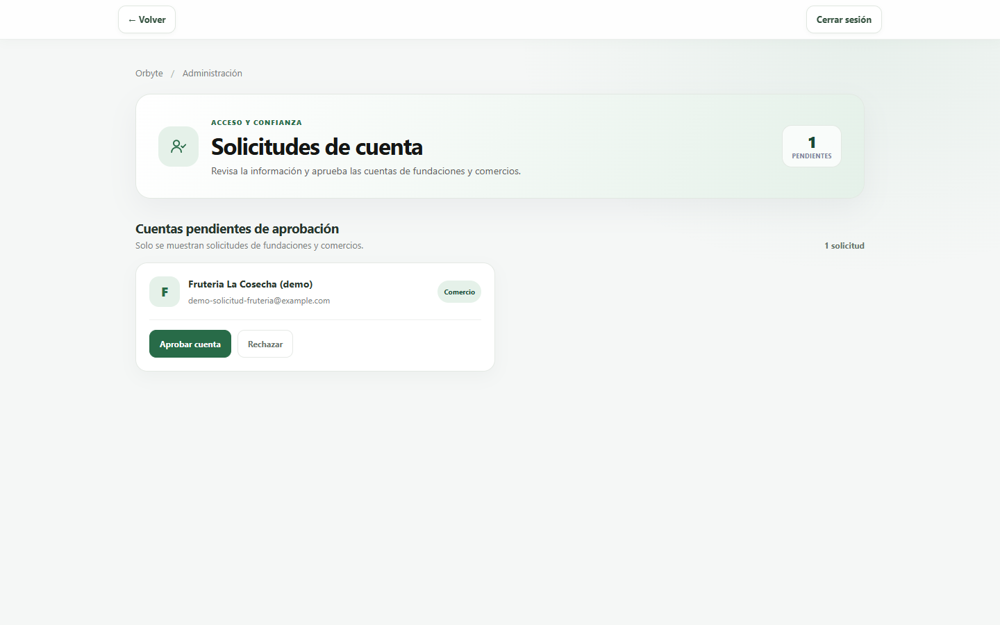

En **Donaciones** puedes consultar el estado de cada donación, quién la publicó y a quién se asignó. Las donaciones finalizadas, no completadas o disponibles pero vencidas se pueden archivar y restaurar después. Archivar las retira del listado principal, pero conserva su historial; las que siguen en curso no se pueden archivar.

### Gestionar comercios (fundación)

En **Inicio → Gestionar comercios**, la fundación ve los comercios por estado: pendientes, activos, desactivados y rechazados. Desde ahí puede:

- **Aprobar** una cuenta pendiente o rechazada.
- **Desactivar cuenta** si un comercio ya no debe entrar. No se borra nada y se puede **reactivar** después.

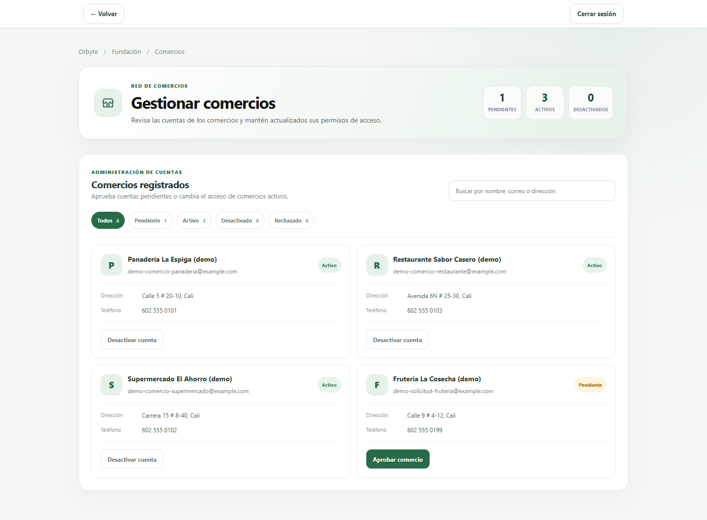

## 3. Tareas de la fundación

Al entrar, la fundación ve sus cuatro tareas principales:

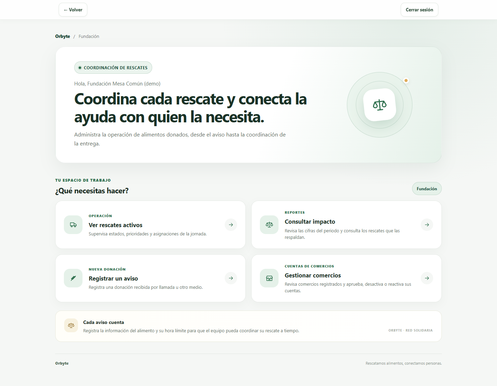

### Ver los rescates activos

**Inicio → Ver rescates activos** muestra los rescates del día, agrupados por estado y ordenados por hora límite:

- Arriba están los totales: **Disponible**, **No disponible** (ya pasó la hora límite), **Asignado** y **Recogido**.
- Puedes buscar por alimento, comercio o voluntario, o filtrar por estado.
- La columna **Aviso creado por** dice si el aviso lo hizo el comercio o la fundación.

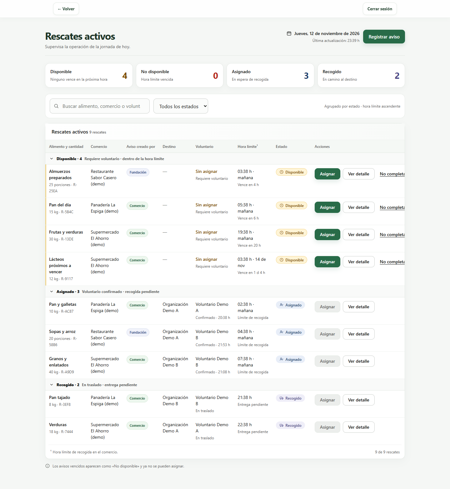

### Registrar un aviso que llegó por llamada (vía alterna)

Si un comercio no puede usar la aplicación, por ejemplo porque no tiene internet o no sabe cómo, avisa por teléfono o WhatsApp. La fundación registra el aviso en su nombre:

1. Toca **Registrar aviso**, en Rescates activos o en el Inicio.
2. En **Comercio**, elige el establecimiento que avisó.
3. Completa el alimento, la cantidad aproximada, el lugar de recogida y la fecha y hora límite (hora de Colombia).
4. Toca **Registrar aviso**. El rescate queda **Disponible**.

Si la aplicación no funciona en ese momento, anota los mismos 5 datos en papel y regístralos apenas vuelva. Ver [Si algo falla](#5-si-algo-falla).

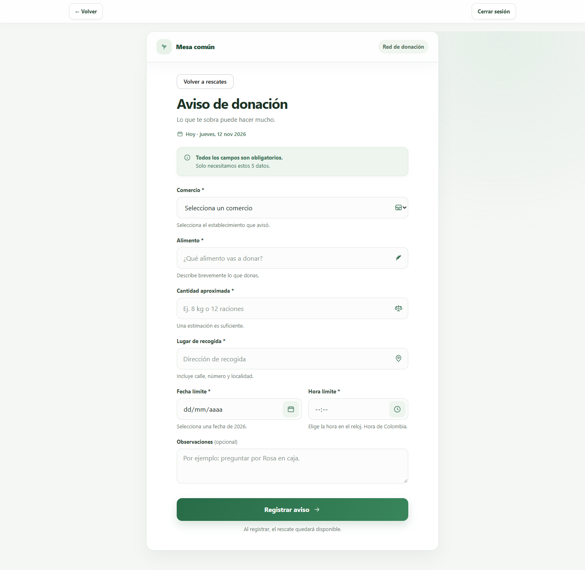

### Asignar un rescate

1. En Rescates activos, toca **Asignar** en un rescate **Disponible**.
2. Elige la **organización receptora**. La lista solo muestra organizaciones con cuenta activa.
3. Elige un **voluntario activo**. Se ve su medio de transporte.
4. Toca **Confirmar asignación**. El rescate pasa a **Asignado**.

Si dos personas intentan asignar el mismo rescate al mismo tiempo, solo una lo logra. La otra recibe un aviso de que el rescate ya no está disponible.

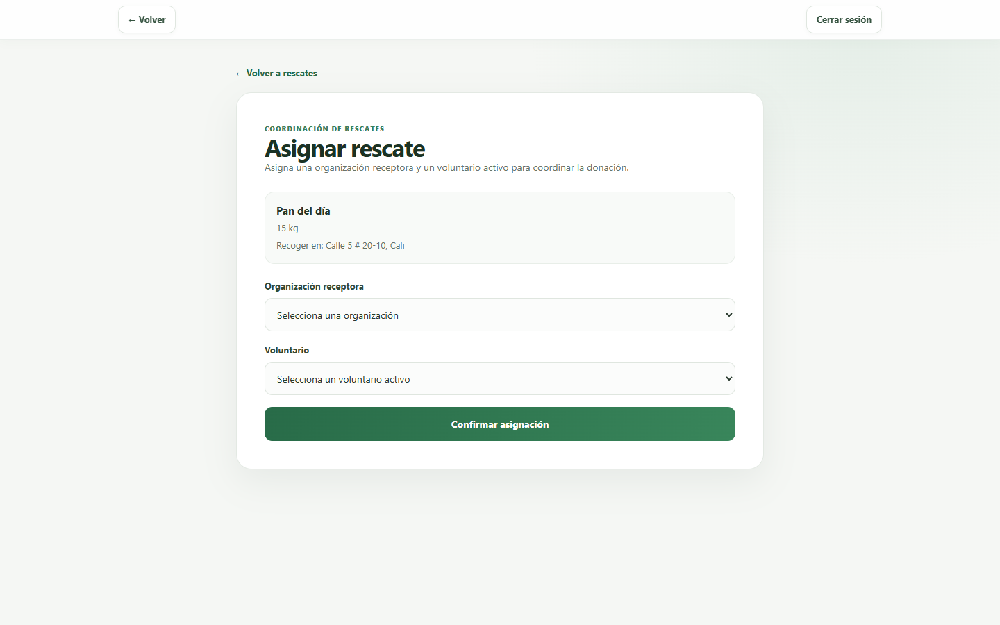

### Cerrar un rescate que no se pudo hacer

En Rescates activos, toca **No completado** en un rescate **Disponible** o **Asignado** y escribe el motivo. El motivo es obligatorio. El rescate no se borra: queda guardado en el historial.

### Ver el detalle y el historial de un rescate

**Ver detalle** muestra los datos del traslado y el **historial**: cada cambio de estado con la fecha, la hora y la persona responsable. El historial no se puede modificar.

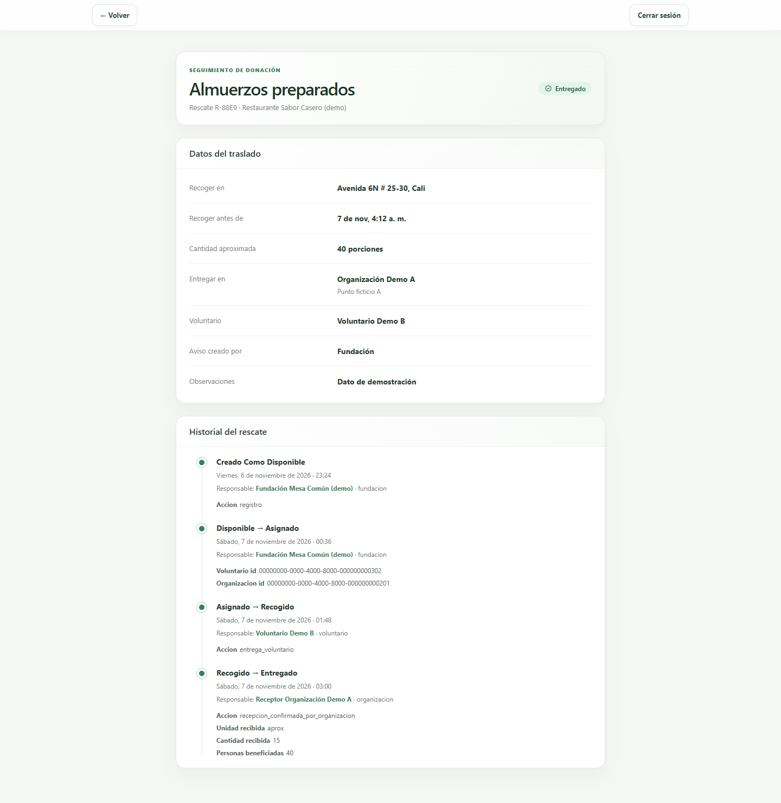

### Consultar el impacto

1. Con una cuenta administradora, abre **Inicio → Administración → Consulta de impacto**.
2. Elige las fechas **Desde** y **Hasta** y toca **Consultar periodo**.
3. Aparecen los kilogramos medidos, las personas beneficiadas, las organizaciones receptoras y los rescates con cantidad estimada (sin kg).
4. **Ver respaldo** en cada cifra muestra los rescates que la forman. Sirve para responder "¿de dónde sale este número?".

Solo cuentan los rescates **entregados** dentro de esas fechas. Si en el periodo no hubo entregas, todo aparece en cero.

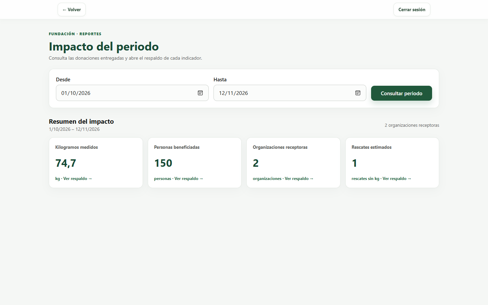

## 4. Lo que hacen comercios, voluntarios y organizaciones

Sirve para explicarles a otras personas qué deben hacer.

### Comercio: publicar y gestionar avisos

- **Publicar alimentos:** el mismo formulario de la fundación, pero el comercio ya viene puesto.
- **Gestionar mis avisos:** muestra sus donaciones por estado. Un aviso **Disponible** y que no haya vencido se puede **editar** o **cancelar**. Cuando ya está asignado, no.

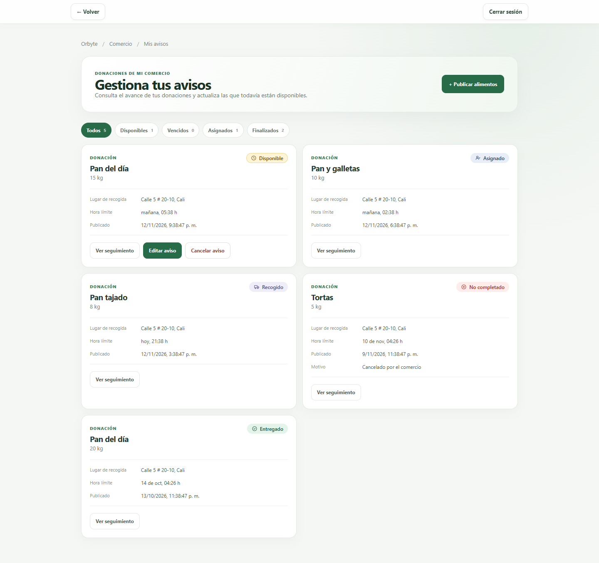

### Voluntario: recoger y entregar

En **Mis rescates asignados**, el voluntario ve dónde recoger, dónde entregar, la cantidad y la hora límite. Al dejar la donación en la organización, toca **Marcar donación entregada**. El rescate pasa a **Recogido**.

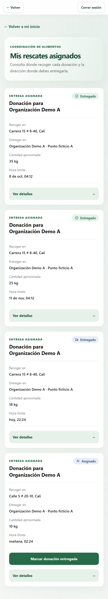

### Organización receptora: confirmar lo que recibió

1. En **Mis rescates asignados**, toca **Confirmar recepción** en la donación que llegó.
2. Escribe la **cantidad recibida**. Elige **Kilogramos** si se pesó o **Cantidad aproximada** si se estimó.
3. Escribe el **total de personas beneficiadas**: solo el número, sin nombres.
4. Toca **Confirmar recepción**. El rescate pasa a **Entregado** y empieza a contar en el impacto.

Si después se sabe el número real de beneficiados, se puede corregir con **Editar conteo**.

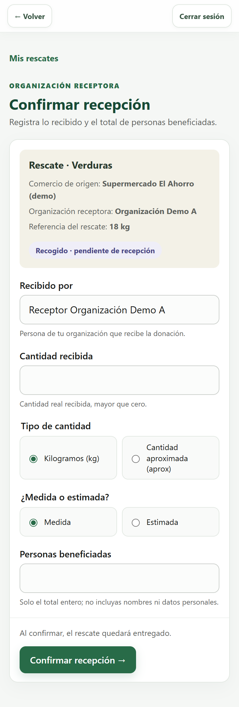

## 5. Si algo falla

| Qué pasa | Qué hacer |
|---|---|
| La aplicación tarda mucho en cargar o el inicio de sesión no responde | El servidor estaba apagado. Espera un minuto o abre https://orbyte-api-ecow.onrender.com/health hasta ver `{"status":"ok"}` y vuelve a intentar |
| Te devuelve a la pantalla de inicio de sesión | La sesión venció, porque dura 60 minutos. Entra de nuevo |
| "No autorizado" o "Permisos insuficientes" | Esa cuenta no tiene permiso para esa pantalla, o fue desactivada. Revisa con qué cuenta entraste |
| No hay internet o la aplicación no responde después de varios minutos | Registra los avisos en papel con los 5 datos (comercio, alimento, cantidad, lugar y hora límite) y pásalos con **Registrar aviso** cuando vuelva |
| Sale un error al guardar | Toma una captura de pantalla con la hora y envíala al equipo técnico. No repitas la acción muchas veces seguidas |

**Datos y respaldos:** la base de datos gratuita no tiene respaldos automáticos. El equipo técnico hace una copia con el script de respaldo. La base gratuita vence el **10 de diciembre de 2026**; antes de esa fecha hay que pasarla al plan pago (ver el [ADR 0001](../decisiones/0001-plan-base-de-datos-render.md)).

## 6. Estados de un rescate

| Estado | Qué significa | Quién lo cambia |
|---|---|---|
| Disponible | Hay alimento esperando un voluntario | Lo crea el comercio o la fundación |
| Asignado | Tiene organización y voluntario | La fundación |
| Recogido | El voluntario ya lo llevó a la organización | El voluntario |
| Entregado | La organización confirmó lo que recibió | La organización |
| No completado | No se pudo hacer, y el motivo queda guardado | La fundación, o el comercio si lo cancela |
| No disponible | Venció la hora límite sin asignarse. Solo se muestra así en pantalla | Nadie: pasa solo |
